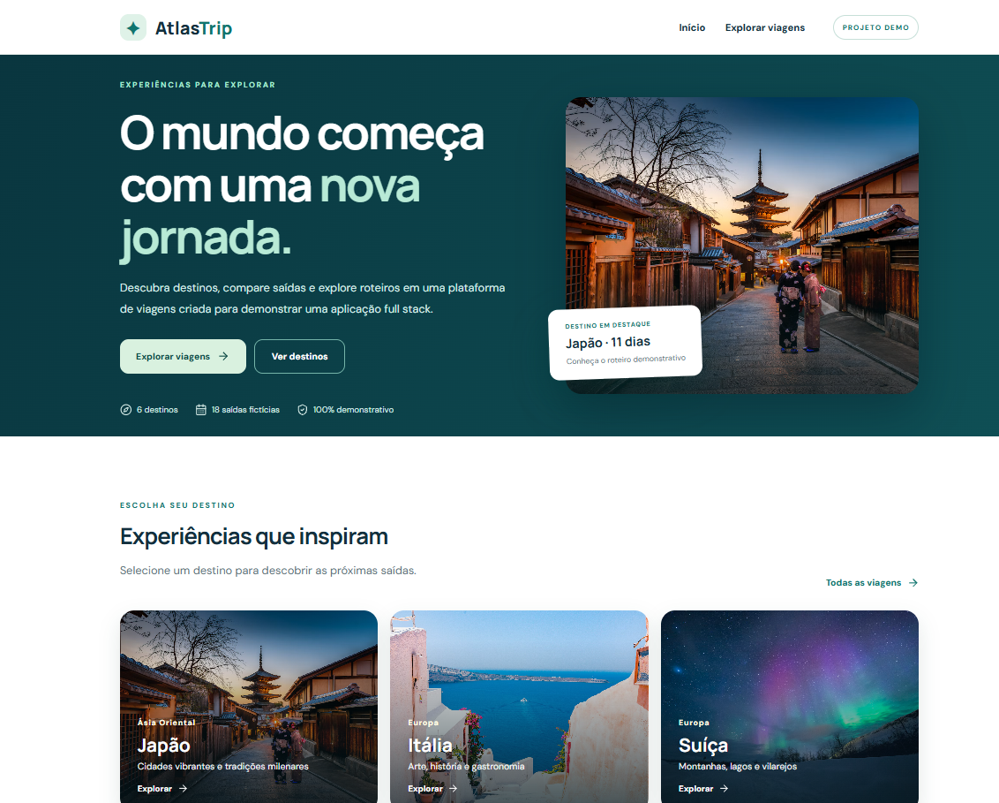
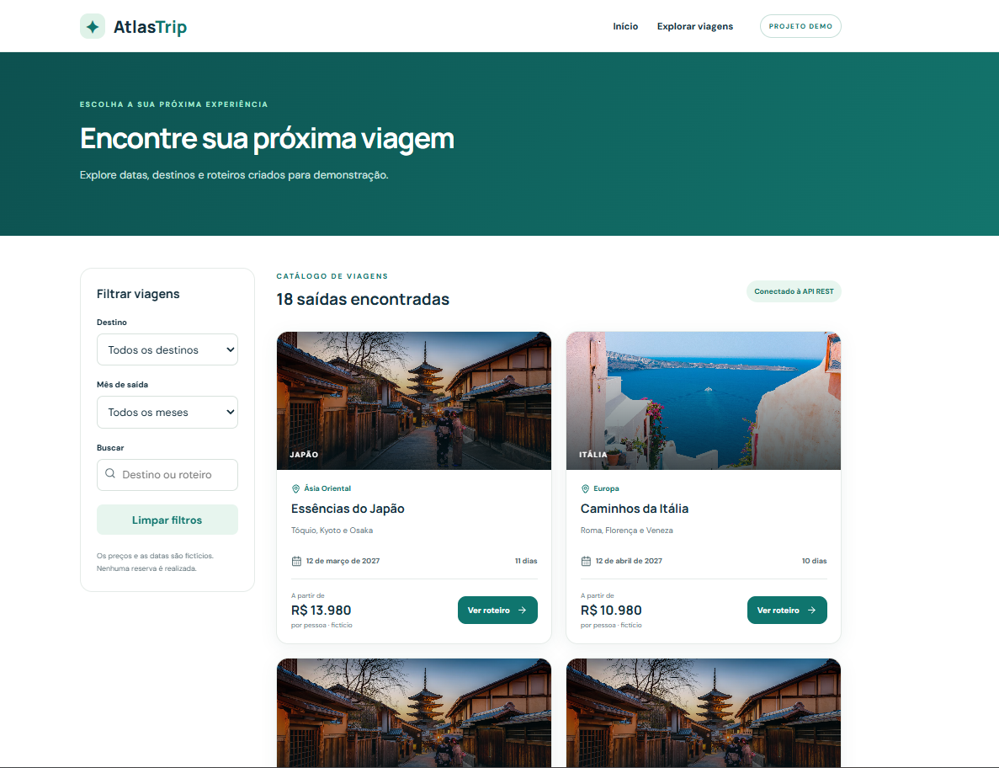
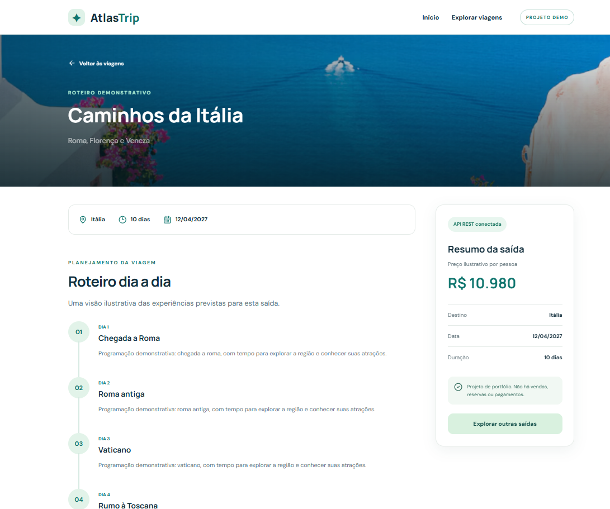

# 🌍 AtlasTrip — Sistema de Gestão de Viagens

Aplicação web **Full Stack** desenvolvida para consulta e organização de viagens e roteiros turísticos, utilizando **Java, Spring Boot, Next.js e TypeScript**.

O projeto tem como objetivo demonstrar conhecimentos em desenvolvimento de aplicações web, construção de APIs REST, integração entre frontend e backend e utilização de bancos de dados relacionais.

## 📸 Screenshots

### 🏠 Página inicial



### ✈️ Catálogo de viagens



### 🗺️ Detalhes do roteiro



## 🚀 Tecnologias utilizadas

### Backend
- Java
- Spring Boot
- Spring Data JPA
- API REST
- H2 Database
- MySQL (configuração opcional)
- Maven

### Frontend
- Next.js
- React
- TypeScript
- CSS
- Consumo de APIs REST

### Ferramentas
- Git e GitHub
- Visual Studio Code

## ⚙️ Funcionalidades

- Catálogo de destinos turísticos com fotografias.
- Consulta de viagens e datas de saída.
- Filtros de viagens por destino.
- Visualização de preços e informações dos pacotes.
- Roteiros turísticos com programação diária.
- Integração entre frontend e backend por meio de API REST.
- Organização de informações utilizando banco de dados relacional.
- Dados fictícios para demonstração.

## 📁 Estrutura do projeto

```text
AtlasTrip/
├── backend/          # API REST com Java e Spring Boot
├── frontend/         # Aplicação Next.js e TypeScript
├── screenshots/      # Imagens das telas do aplicativo
│   ├── home.png
│   ├── viagens.png
│   └── roteiro.png
├── .gitignore
└── README.md
```

## 💻 Como executar o projeto

### 1. Backend — Java e Spring Boot

**Pré-requisitos:** Java e Maven compatíveis com o projeto.

Abra um terminal na raiz do projeto e execute:

```bash
cd backend
mvn spring-boot:run
```

### 2. Frontend — Next.js

**Pré-requisitos:** Node.js e npm.

Abra outro terminal na raiz do projeto e execute:

```bash
cd frontend
npm install
npm run dev
```

A aplicação estará disponível em:

**http://localhost:3000**

## 🗄️ Banco de dados

O projeto utiliza **H2 Database** para facilitar a execução em ambiente de desenvolvimento, permitindo testar a aplicação sem configurar um banco externo.

Também possui suporte opcional ao **MySQL**, por meio das configurações do Spring Boot.

## 🎯 Objetivo do projeto

O AtlasTrip foi desenvolvido como um projeto independente de portfólio, utilizando informações fictícias e sem conexão com sistemas reais de empresas.

A aplicação demonstra conceitos de desenvolvimento Full Stack, com foco em:

- Desenvolvimento Backend com Java e Spring Boot.
- Construção e consumo de APIs REST.
- Integração entre aplicações frontend e backend.
- Persistência de dados com Spring Data JPA.
- Desenvolvimento de interfaces web com Next.js e TypeScript.
- Organização de projetos e versionamento de código com Git.

## 👨‍💻 Autor

**Gustavo Basilio Salzedas**

Formado em Análise e Desenvolvimento de Sistemas, com foco em desenvolvimento Backend utilizando Java e Spring Boot.

**GitHub:** [github.com/gbasilio321](https://github.com/gbasilio321)

---

⭐ Projeto desenvolvido para fins educacionais e de portfólio profissional.
